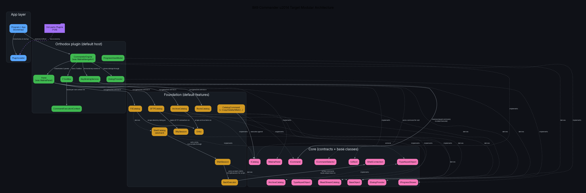
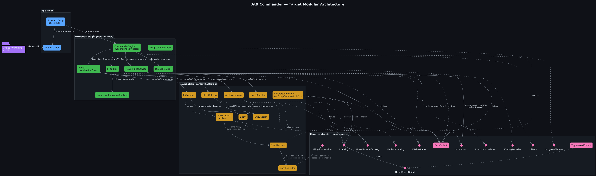

# Bashka — Target Architecture

*(Diagram source: `architecture.dot`, regenerate with `dot -Tpng architecture.dot -o architecture.png`.)*

This diagram shows the proposed modular split of the current single-assembly
`AutFac` project (see `.junie/plans/bashka-architecture-plan.md` for
the full write-up). Each colored cluster is a future assembly:

- **App layer** (blue) — `Program`/`App` bootstrap and the `PluginLoader`
  that discovers third-party plugin `*.dll` files at startup.
- **Orthodox plugin** (green) — the default two-panel host, built around
  `CommanderEngine` (today's `MalinaNavigator`), `Panel` (today's
  `MalinaPanel`) and `FToolBox`. It also owns supporting UI-side services
  such as `KeyBindingService`, `DialogProvider`, `ProgressViewModel` and
  `CommandExecutionContext`. It is a *plugin*, not the app itself.
- **Foundation** (orange) — the always-loaded default catalogs, entries and
  executors: `FSCatalog`, `SFTPCatalog`, `ArchiveCatalog`, `RootsCatalog`,
  `Entry`, `ShellCatalog`, `BashExecutor`, `ShellSession`, `SftpSession`,
  and the family of `CatalogCommand`-derived commands (copy/delete/mkdir/etc.).
  Note the real inheritance/usage chain: `FSCatalog` **derives from**
  `ShellCatalog`, which **uses** `ShellSession`, which in turn **selects**
  `BashExecutor` as its `IScriptExecutor` backend — `FSCatalog` never talks
  to `BashExecutor` directly.
- **Core** (pink) — pure contracts and tiny base classes shared by
  everything: `ICatalog`, `ICommand`, `ICommandSelector`, `IUiRoot`,
  `IMalinaPanel`, `IShellConnection`, `IArchiveCatalog`,
  `IReadStreamCatalog`, `IDialogProvider`, `IProgressShower`,
  `ITypeKeyedObject`/`TypeKeyedObject` and `BaseObject`.
- **3rd-party plugins** (purple folder) — external assemblies dropped in
  later, wired in through the same `PluginLoader`/`ICatalog`/`ICommand`
  contracts as the built-in Foundation/Orthodox pieces.

Every arrow carries a label describing the actual mechanism (e.g. `ShellSession`
**picks as best-match `IScriptExecutor` for script** `BashExecutor`, which then
**writes command, reads output lines via** `IShellConnection`), so the diagram
doesn't just show *that* two types are connected but *how*, based on reading the
real code (`ShellSession.PrepareQuery`, `ShellHelper.BestMatch`,
`BashExecutor.PrepareScriptExecution`) instead of generic verbs like "uses" or
"produces". Solid arrows are runtime/compile dependencies, dotted arrows are
`implements`/`derives` relationships, and the dashed arrow shows how external
plugins are discovered rather than referenced directly. The `Core` cluster is
laid out in two compact rows
rather than one long column, so the diagram stays wide and readable instead
of stretching vertically. The intent is that `Core` never depends on
anything else, `Foundation` and `Orthodox` only depend on `Core`, and `App`
is the only place that knows about concrete plugins — which is exactly what
makes the plugin system possible.

## Alternative rendering (PlantUML)

A second version of the same architecture, generated with a different tool
(PlantUML instead of Graphviz), is available as `architecture.puml` /
`architecture-plantuml.png`:

*(Regenerate with `java -jar plantuml.jar -tpng architecture.puml` and rename
the resulting `Bashka.png` to `architecture-plantuml.png`.)*

It models the same clusters/classes/interfaces and relationships as
`architecture.dot`, using PlantUML's component/interface notation
(`..|>` for implements, `..>` for derives, plain arrows for uses) instead of
hand-labeled Graphviz edges.
